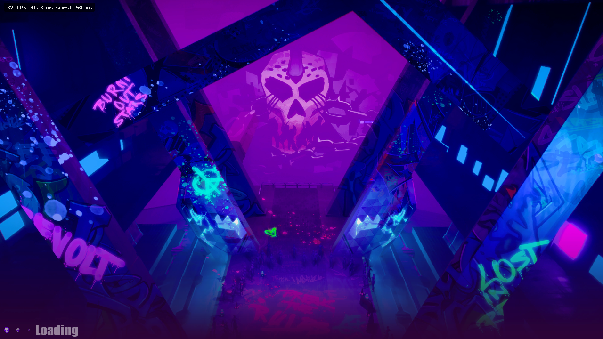

<h1 align="center">
  <br>
  <a>
  
</a>

  <br>
  <b>UEWASM</b>
  <br>
</h1>

<h4 align="center">A WIP Static Recompilation tool for Windows x64 and x86 Unreal Engine 4/5 built games into WebAssembly (WASM)
</h4>

</p>

UEWASM is a tool that uses games you own, and turns them into a recompiled WebAssemably project.
This tool **doesn't enable piracy on its own**, and any games redistributed with this tool are 
**responsibility of the distributer, not T4ctica1**. As of today this tool supports games made 
in Unreal Engine 4 and 5, while plans to add support for Unreal Engine 3 are planned, nothing 
is implemented yet.
<br>

> [!IMPORTANT]
> This repository **does not contain any games or built recomplilations, this project is also not affiliated with Epic Games or any Publishers (or other) of games mentioned**.
> You need your own copy of any game you would like to recompile. Everything this tool creates 
> comes from your game and stays on your PC. Never share the generated files publicly.

## How it works

1. **Loader and linker** (`uewasm/recomp/pe.py`, `link.py`): parses the exe and every DLL it needs, relocates
   them into one guest address space and resolves imports the way Windows does. Microsoft's CRT DLLs and the
   game's own DLLs are recompiled too, so only the operating-system layer has to be reimplemented. SteamStub-wrapped
   executables are unwrapped (`steamstub.py`).
2. **Discovery**: functions come from `.pdata` (including chained chunks), entry points, exports, relocated code
   pointers and call targets; switch tables are recovered per function family.
3. **Lifter** (`lift.py`, `sse.py`, `x87.py`): each x86-64 (or 32-bit x86) function becomes a C function. Registers
   live in locals and flags are lazy, so a compare and branch compile to a single comparison; indirect calls go
   through per-site inline caches; SSE (up to SSE4.2) maps to WebAssembly SIMD. 32-bit games get the x87 FPU and
   stdcall/cdecl calling conventions on top.
4. **Runtime** (`runtime/`):
   - guest heap, files (game data fetched on demand; a separate save folder), Win32/USER32 windowing and input;
   - green threads with Windows synchronisation semantics (events, mutexes, critical sections, SRW locks,
     condition variables, WaitOnAddress), scheduled cooperatively on one browser thread via JSPI, or spread over
     several cores with `--threads real`;
   - Direct3D 11/DXGI on WebGPU: DXBC shaders are translated to WGSL (`dxbc_wgsl.c`), including geometry shaders
     (emulated with compute), typed buffers read and written in their real formats, UAV-only passes, background
     pipeline compilation and GPU timestamp queries;
   - XAudio2 2.7 (mixer, submixes, reverb, X3DAudio) and WASAPI on an AudioWorklet; Ogg Vorbis and VP8/VP9 video
     are decoded natively or by the browser's hardware decoder where the game ships libvorbis/libvpx.

Desktop apps:

- `app/` (Rust, egui): `cargo build --release --target x86_64-pc-windows-msvc` in `app/`. It runs the build through the
  command line (`uewasm-cli.exe` beside it, or `uewasm.py` with Python) and serves finished builds itself.
- The original Tkinter app (the release `UEWASM.exe`): settings on tabs (*Build*, *Graphics & performance*, *Game
  files*, *Online*, *Tools*), each with a note on what it does. `pip install pyinstaller`, then `python build_exe.py`
  (writes `dist/UEWASM.exe`, with the Rust recompiler built in).

## Requirements

- Windows 10/11, x64
- Python 3.11+ (only for running from source; the release `UEWASM.exe` bundles it)
- [Emscripten SDK](https://emscripten.org/docs/getting_started/downloads.html). The desktop app finds it in
  `%USERPROFILE%\emsdk` or wherever the `EMSDK` environment variable points; another folder can be chosen on its
  *Tools* tab (or with `--emsdk PATH`). Without it, the app stops before building and offers to install it
  (about 2.5 GB); `uewasm install-emsdk [folder]` does the same from the command line. The first build downloads
  Emscripten's libogg/libvorbis ports, so it needs an internet connection once.
- A browser with WebGPU and JavaScript Promise Integration: current Chrome or Edge.
- Only for some settings (the app checks before building, and offers to install what it can or to turn the setting
  off; `uewasm doctor` lists them all):
  - Visual Studio Build Tools with C++ (MSVC): native verification builds (`--native`);
  - Rust: the Rust recompiler when running from source (`UEWASM.exe` bundles it);
  - Binaryen (part of Emscripten): `--wasm-opt`.

## UEWASM Status and Support

This project is in its early stages, meaning **not all games work**. 

Here are the games used for Testing and some screenshots of the tool working

| Game | Status | FPS In Game | UE Version | UEWASM Version Used |
|---|---|---|---|---|
| Hello Neighbor | ✅ Works | 30-60 FPS Depending on the Area| UE 4.20.3 | PR 0.1.1 |
| Dispatch | ✅ Perfect | >60 FPS | UE 4.27 | PR 0.1.0 |
| Hello Neighbor: Renovated | ✅ Works (MANY Visual Bugs) | 30-40 FPS | UE 4.? | PR 0.1.2 |
| Crab Champions | ✅ Works (Lobby and gameplay) | 25-30 FPS | UE 4.27 | PR 0.1.2 |
| Grandpa High on Retro | ✅ Works (Menu, intro and gameplay) | 30-55 FPS | UE 5 | PR 0.1.2 |
| Dead as Disco | ➖ Gets in game (Tutorial, Crashes mid way through) | 30-50 FPS | UE 5.7.4 | PR 0.1.3 |

 <td align="center">
      <strong>Hello Neighbor</strong><br>
      
    </td>
    <td align="center">
      <strong>Dispatch</strong><br>
      
    </td>
    <td align="center">
      <strong>Dead As Disco</strong><br>
      
    </td>
    
## Building Options

When building a game with UEWASM, the tool give you many choices on how the game can be built such as the following:

| Option | Choices | Notes |
| --- | --- | --- |
| `--priority` | `high` (default), `low` | How much of the PC the build uses; the result is identical. `high` is tuned to the PC (cores and free memory) for speed while running below normal priority; `low` uses about half the cores and a fifth of the memory at idle priority, so the PC stays usable. |
| `--renderer` | `webgpu` (default), `webgl2` | WebGPU is faster and supports compute shaders. `webgl2` builds only the WebGL path. |
| `--threads` | `coop` (default), `real` | `coop`: game threads take turns on one browser thread; runs on any host. `real`: game threads run on several cores (Web Workers), with the render and audio threads on the page's own thread. Needs WebGPU and https or localhost; hosts that can't send the cross-origin isolation headers get them from a small service worker included in the build. |
| `--opt` | `-O2`, `-O3`, `-Os` | Speed vs. download size. |
| `--emsdk` | folder | Where the Emscripten SDK is, if not in `%USERPROFILE%\emsdk` or `EMSDK` (the desktop app's choice is used otherwise). |
| `--lifter` | `python` (default), `rust` | Which recompiler turns the machine code into C. `rust` (`rustlift/`) produces the same output several times faster; it needs a Rust toolchain and is built automatically the first time. |
| `--mem-mb` | number | Guest memory; browsers allow 4096 MB total. |
| `--mem-limit-gb` | number (default `8`) | How much memory the built game may use when run, split between game memory, the download cache and video memory. |
| `--aes-key` | `0x` + 64 hex digits | Decrypt AES-encrypted `.pak` files with your own key so the browser can read them. The key is checked before the build starts; a wrong key stops the build. |
| `--resolution` | e.g. `1280x720` | Render size. The page scales it to fit the window, so a lower value helps slow machines. |
| `--part-mb` | number | Largest file in the output. The default of 16 stays under Cloudflare Pages' 25 MiB limit. |
| `--compress` |N/A| Compress the game's files (audio excluded) for a smaller download. |
| `--single-file` |N/A| Also write one `.html` file holding the whole game (code and files), which plays when opened straight from disk with no server. Cooperative threads only; best for smaller games, since the whole page is loaded at once. |
| `--video-height` | e.g. `720` | Re-encode game videos taller than this, in their original codec family, so the game's own player still plays them. Unreal `.pak` files are rewritten with the new videos. `0` (default) keeps the originals. |
| `--video-mode` | `fast`, `small` | `small` gives roughly 30% smaller videos but encodes about 10 times slower. Encodes are cached. |
| `--sync-shaders` |N/A| Compile each shader when first drawn instead of in the background (exact first frames, but freezes while compiling). |
| `--quality` | `game` (default), `low`, `medium`, `high`, `epic` | Unreal games: graphics quality for every scalability group except textures, added to the game's own settings file (`GameUserSettings.ini`) each time it starts, so it also overrides what the game saved there. Translated draw calls cost CPU time here, so lower settings run faster (Dead as Disco, single-threaded: about 10% at `low`). `low` and `medium` keep auto exposure and the full tonemapper (contrast, vignette), and shadows stay at least medium: without them scenes come out too dark, too flat, or lit through walls. A game that picks its settings with a hardware check on its very first start keeps that pick for that one session. |
| `--game-arg` | any | Extra launch argument for the game, added after the automatic ones (such as `-dx11`); repeat for more. |
| `--fps` |N/A| Show an FPS counter (Ctrl+Shift+F toggles it in game). |
| `--names` |N/A| Keep function names in the module, so the browser's profiler shows which game and runtime functions take the time. Doesn't slow the game; relinking with it doesn't recompile. |
| `--no-debug-panel` |N/A| Leave the debug panel out of the build entirely (see below). |
| `--wasm-opt` |N/A| Run Binaryen over the module: ~10% smaller, needs about 20x the module size in RAM. |
| `--game-dlls` | `auto`, `none` | Also recompile DLLs shipped with the game (PhysX, codecs, middleware). |
| `--no-system-dlls` |N/A| Use the built-in CRT instead of recompiling Microsoft's runtime DLLs. |
| `--native` |N/A| Also build a native Windows binary of the recompiled code, for verification. |
| `--backend` | `none` (default), `epic` | Serve the game's online services from the page itself: `epic` answers Epic account, entitlement and content requests offline so games that require a login can start. |
| `--placeholders` |N/A| With `--backend`, answer requests for downloadable content the build lacks with empty stand-in files. |

## In the game

- **Debug panel**: If enabled, press `\` or Insert to show. Live FPS, GPU and memory numbers, recent hitches, game speed (1x to 8x), save
  export/import, a log you can save, a thread dump, frame capture, and switches that apply on reload.
  
- **Unreal Engine developer console**: the panel's *Enable UE dev console* attaches the engine's own console (the
  one shipping builds leave out), then `~` opens it. It finds everything through the engine's reflection data, so
  it works across UE4 and UE5 versions. It can be enabled on every launch.
  
- Builds made with `--no-debug-panel` (or with the desktop app's *UEWASM debug toggle* unticked) contain none of
  this: the panel script, the console enabler and the debug hooks are not compiled in.

Page parameters: `?arg=-foo` adds launch arguments; `?filetrace=1`, `?netdebug=1` and `?tracering=1` log file access, network traffic and the last engine calls before a crash.

## Hosting

`builds\MyGame\web` is a plain static site: upload the whole folder (Cloudflare Pages or any static host). It holds:

- `index.html`, `game.js`, and the module, split into `game.wasm.0`, `game.wasm.1` and so on when large (the parts
  download together and compile as they arrive).
- `data/`: the game's files, cut into parts, plus `index.txt`. The browser downloads each part in 1 MiB blocks
  when the game reads it, merging neighbouring blocks into larger requests, and remembers what was read during
  boot so later launches fetch it ahead of time. HTTP Range support saves bandwidth; servers without it still work.

Saves and settings go to IndexedDB, so they survive reloads. Executables and debug files are never uploaded.

If the graphics driver resets mid-game (Windows does this when a slow or integrated GPU takes over ~2 s on one batch
of work), the page says so and restarts itself once to get a working GPU again, instead of playing on with a blank
screen. GPU work is sent in smaller batches on integrated GPUs to make that rarer.

## Testing

```
python tests/run_tests.py          # C, C++ STL, threads, files: original exe vs native recompile vs wasm
python tests/run_tests.py --threads real   # the same with guest threads on several cores
python tests/gfx/run_gfx.py webgpu # D3D11 triangle rendered in a headless browser, checked per pixel (or webgl2)
python tests/isa/run_isa.py --wasm # ~1200 instruction forms on random inputs: real CPU vs recompiled, bit-exact
python tests/web/run_web.py        # game files over HTTP (raw and deflated, with and without Range) and saved progress
python tests/sse/gen_test.py       # SIMD versions of the SSE helpers against their scalar references
```

The browser tests need Playwright (`pip install playwright`, then `playwright install msedge` or use an installed
Edge/Chrome).

## Known limitations

- Cooperative builds run every game thread on one browser thread, so CPU-heavy games are limited to roughly what
  one core can do. `--threads real` spreads them over several cores, but every system call still passes through one
  lock, so the gain depends on the game.
- Shaders compile the first time an effect appears, which can cause short stutters on a first run; browsers cache
  them afterwards.
- Hull/domain (tessellation) shaders are not supported; those draws are skipped.
- Unreal Engine 5 support is newer than UE4: tested UE5 games reach their menus and gameplay, but they run slower
  than UE4 titles and the first visit to each area stutters while shaders compile.
- Executables encrypted or packed by anti-tamper protection can't be recompiled.
- Only the APIs the tested games use are implemented in depth; other games may stop at an unimplemented call.

## Extra Credits

- **[IdiotOnline](https://github.com/anIdiotonline)** - Tester

- **[teaser.lua](https://github.com/teaserlua)** - Tester

- **[NotRexed](https://github.com/notrexed)** - Took too long to make his tool (Rexcomp) / Inspired the making of UEWASM

> [AI Use Disclosure]
> This project was made mostly by AI, but WAS overlooked and corrected by a human.
