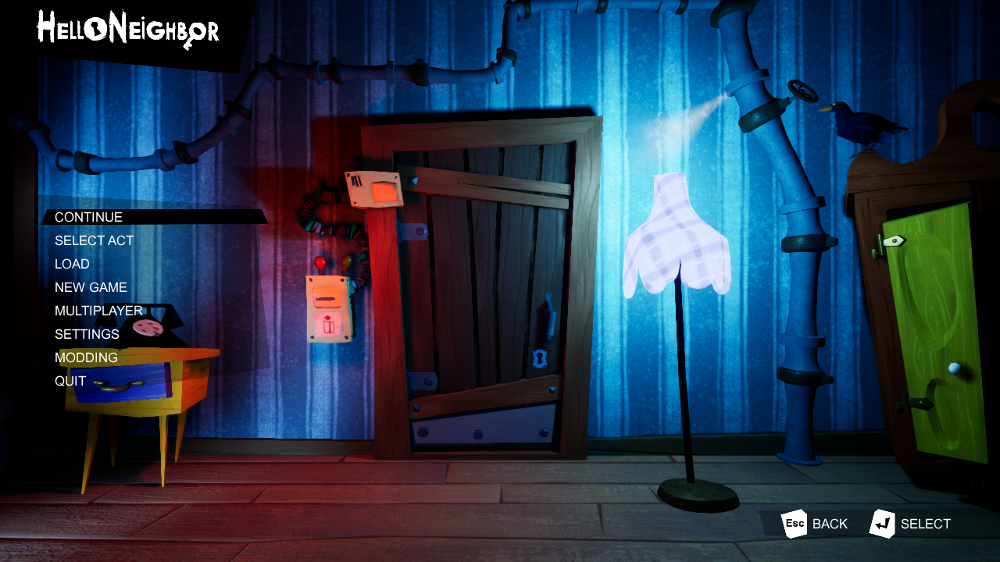

<h1 align="center">
  <br>
  <a>
  
</a>

  <br>
  <b>UEWASM</b>
  <br>
</h1>

<h4 align="center">A Static Recompilation tool for Windows x64 Unreal Engine 4/5 built games into WebAssemably (WASM)
</h4>

</p>

UEWASM is a tool that uses games you own, and turns them into a recompiled WebAssemably project.
This tool **doesn't enable piracy on its own**, and any games redistributed with this tool are 
**responsibility of the distributer, not T4ctica1**. As of today this tool supports games made 
in Unreal Engine 4 and 5, while plans to add support for Unreal Engine 3 are planned, nothing 
is implemented yet.
<br>

> [!IMPORTANT]
> This repository **does not contain any games or built recomplilations**.
> You need your own copy of any game you would like to recompile. Everything this tool creates 
> comes from your game and stays on your PC. Never share the generated files publicly.

## How it works

1. **Loader and linker** (`uewasm/recomp/pe.py`, `link.py`): parses the exe and every DLL it needs, relocates
   them into one guest address space and resolves imports the way Windows does. Microsoft's CRT DLLs and the
   game's own DLLs are recompiled too, so only the operating-system layer has to be reimplemented. SteamStub-wrapped
   executables are unwrapped (`steamstub.py`).
2. **Discovery**: functions come from `.pdata` (including chained chunks), entry points, exports, relocated code
   pointers and call targets; switch tables are recovered per function family.
3. **Lifter** (`lift.py`, `sse.py`): each x86-64 function becomes a C function. Registers live in locals and
   flags are lazy, so a compare and branch compile to a single comparison; indirect calls go through per-site
   inline caches; SSE maps to WebAssembly SIMD.
4. **Runtime** (`runtime/`):
   - guest heap, files (game data fetched on demand; a separate save folder), Win32/USER32 windowing and input;
   - green threads with Windows synchronisation semantics (events, mutexes, critical sections, SRW locks,
     condition variables, WaitOnAddress), scheduled cooperatively on one browser thread via JSPI;
   - Direct3D 11/DXGI on WebGPU: DXBC shaders are translated to WGSL (`dxbc_wgsl.c`), including geometry shaders
     (emulated with compute), with background pipeline compilation and GPU timestamp queries;
   - XAudio2 2.7 (mixer, submixes, reverb, X3DAudio) and WASAPI on an AudioWorklet; Ogg Vorbis and VP8/VP9 video
     are decoded natively or by the browser's hardware decoder where the game ships libvorbis/libvpx.

To build the desktop app: `pip install pyinstaller`, then `python build_exe.py` (writes `dist/UEWASM.exe`).

## Requirements

- Windows 10/11, x64
- Python 3.11+ (only for running from source; the release `UEWASM.exe` bundles it)
- [Emscripten SDK](https://emscripten.org/docs/getting_started/downloads.html), installed in `%USERPROFILE%\emsdk`
  or wherever the `EMSDK` environment variable points. The first build downloads Emscripten's libogg/libvorbis
  ports, so it needs an internet connection once.
- A browser with WebGPU and JavaScript Promise Integration: current Chrome or Edge.
- Optional: Visual Studio Build Tools (MSVC), only for native verification builds (`--native`).

## UEWASM Status and Support

This project is in its early stages, meaning not all games work. Here are the games used for Testing and some screenshots of the tool working

| Game | Status | FPS |
|---|---|---|
| Hello Neighbor | ✅ Works | 30-60 FPS Depending on the Area|
| Dispatch | ✅ Perfect | >60 FPS |
| Hello Neighbor: Renovated | ✅ Works (Visual Bugs) | 30-40 FPS |

 <td align="center">
      <strong>Hello Neighbor</strong><br>
      
    </td>
    <td align="center">
      <strong>Dispatch</strong><br>
      
    </td>

## Building Options

When building a game with UEWASM, the tool give you many choices on how the game can be built such as the following:

| Option | Choices | Notes |
| --- | --- | --- |
| `--priority` | `high` (default), `low` | How much of the PC the build uses; the result is identical. `high` is tuned to the PC (cores and free memory) for speed while running below normal priority; `low` uses about half the cores and a fifth of the memory at idle priority, so the PC stays usable. |
| `--renderer` | `webgpu` (default), `webgl2` | WebGPU is faster and supports compute shaders. `webgl2` builds only the WebGL path. |
| `--threads` | `coop` | Game threads run as green threads on one browser thread. (`real`, Web Workers, is not implemented yet.) |
| `--opt` | `-O2`, `-O3`, `-Os` | Speed vs. download size. |
| `--mem-mb` | number | Guest memory; browsers allow 4096 MB total. |
| `--resolution` | e.g. `1280x720` | Render size. The page scales it to fit the window, so a lower value helps slow machines. |
| `--part-mb` | number | Largest file in the output. The default of 16 stays under Cloudflare Pages' 25 MiB limit. |
| `--compress` |N/A| Compress the game's files (audio excluded) for a smaller download. |
| `--video-height` | e.g. `720` | Re-encode game videos taller than this, in their original codec family, so the game's own player still plays them. Unreal `.pak` files are rewritten with the new videos. `0` (default) keeps the originals. |
| `--video-mode` | `fast`, `small` | `small` gives roughly 30% smaller videos but encodes about 10 times slower. Encodes are cached. |
| `--sync-shaders` |N/A| Compile each shader when first drawn instead of in the background (exact first frames, but freezes while compiling). |
| `--fps` |N/A| Show an FPS counter (Ctrl+Shift+F toggles it in game). |
| `--no-debug-panel` |N/A| Leave the debug panel out of the build entirely (see below). |
| `--wasm-opt` |N/A| Run Binaryen over the module: ~10% smaller, needs about 20x the module size in RAM. |
| `--game-dlls` | `auto`, `none` | Also recompile DLLs shipped with the game (PhysX, codecs, middleware). |
| `--no-system-dlls` |N/A| Use the built-in CRT instead of recompiling Microsoft's runtime DLLs. |
| `--native` |N/A| Also build a native Windows binary of the recompiled code, for verification. |

## In the game

- **Debug panel**: If enabled, press `\` or Insert to show. Live FPS, GPU and memory numbers, recent hitches, game speed (1x to 8x), save
  export/import, a log you can save, a thread dump, frame capture, and switches that apply on reload.
  
- **Unreal Engine developer console**: the panel's *Enable UE dev console* attaches the engine's own console (the
  one shipping builds leave out), then `~` opens it. It finds everything through the engine's reflection data, so
  it works across UE4 and UE5 versions. It can be enabled on every launch.
  
- Builds made with `--no-debug-panel` (or with the desktop app's *UEWASM debug toggle* unticked) contain none of
  this: the panel script, the console enabler and the debug hooks are not compiled in.

## Hosting

`builds\MyGame\web` is a plain static site: upload the whole folder (Cloudflare Pages or any static host). It holds:

- `index.html`, `game.js`, and the module, split into `game.wasm.0`, `game.wasm.1` and so on when large.
- `data/`: the game's files, cut into parts, plus `index.txt`. The browser downloads each part in 1 MiB blocks
  when the game reads it, merging neighbouring blocks into larger requests, and remembers what was read during
  boot so later launches fetch it ahead of time. HTTP Range support saves bandwidth; servers without it still work.

Saves and settings go to IndexedDB, so they survive reloads. Executables and debug files are never uploaded.

## Testing

```
python tests/run_tests.py          # C, C++ STL, threads, files: original exe vs native recompile vs wasm
python tests/gfx/run_gfx.py webgpu # D3D11 triangle rendered in a headless browser, checked per pixel (or webgl2)
python tests/isa/run_isa.py --wasm # ~1200 instruction forms on random inputs: real CPU vs recompiled, bit-exact
python tests/web/run_web.py        # game files over HTTP (raw and deflated, with and without Range) and saved progress
python tests/sse/gen_test.py       # SIMD versions of the SSE helpers against their scalar references
```

The browser tests need Playwright (`pip install playwright`, then `playwright install msedge` or use an installed
Edge/Chrome).

## Known limitations

- Everything runs on one browser thread, so CPU-heavy games are limited to roughly what one core can do through
  the recompiled code. Real multithreading (Web Workers) is the next big step.
- Shaders compile the first time an effect appears, which can cause short stutters on a first run; browsers cache
  them afterwards.
- Hull/domain (tessellation) shaders are not supported; those draws are skipped.
- Only the APIs the tested games use are implemented in depth; other games may stop at an unimplemented call
  (`coverage` lists what a build still misses).

## Extra Credits

- **[teaser.lua](https://github.com/teaserlua)** - Tester

- **[NotRexed](https://github.com/notrexed)** - Kept his tool (Rexedcomp) private / Inspired the making of UEWASM

> [AI Use Disclosure]
> This project was made mostly by AI, but WAS overlooked and corrected by a human.
