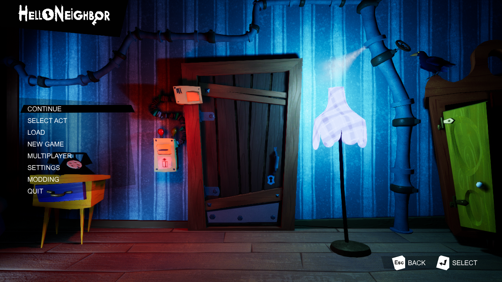
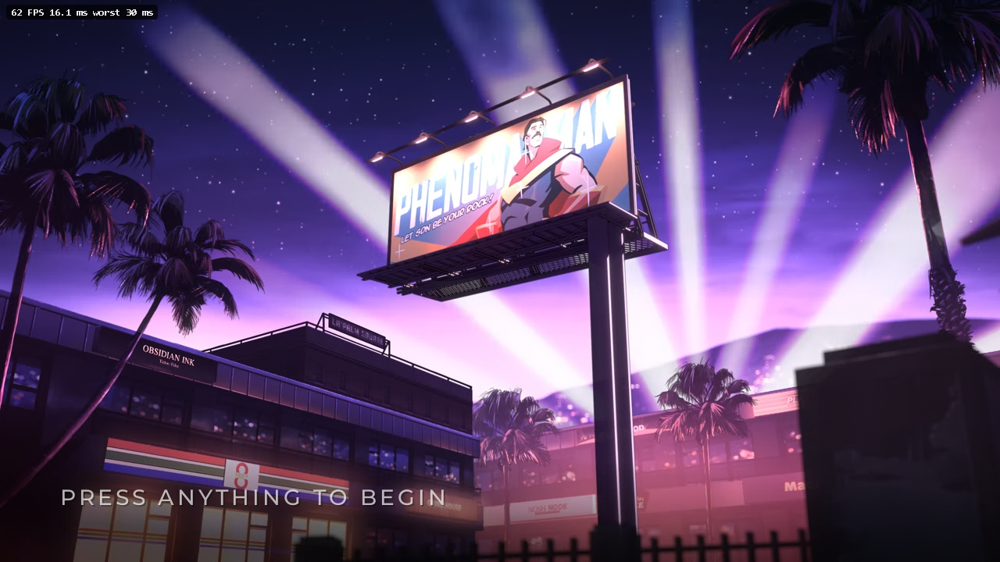
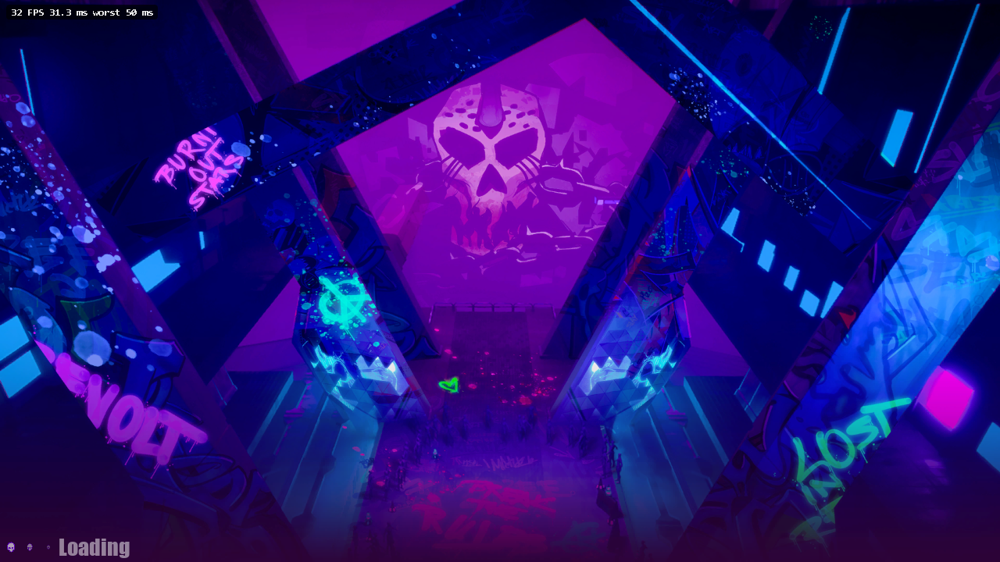

<h1 align="center">
  <br>
  <a>
  
</a>

  <br>
  <b>UEWASM</b>
  <br>
</h1>

<h4 align="center">A WIP Static Recompilation tool for Windows x64 and x86 Unreal Engine 3, 4 and 5 built games into WebAssembly (.wasm)
</h4>

</p>

UEWASM is a tool that uses games you own, and turns them into a recompiled WebAssembly project.
This tool **doesn't enable piracy on its own**, and any games redistributed with this tool are 
**responsibility of the distributer, not T4ctica1 or zay, nor anyone afiliated with this project**. As of today this tool supports games made 
in Unreal Engine 3, 4 and 5. Unreal Engine 3 games run both as 32-bit Direct3D 9 titles (Dishonored) and as 64-bit
Direct3D 11 titles (Rocket League): see the status table and [Unreal Engine 3 games](#unreal-engine-3-games).
<br>

> [AI Use Disclosure]
> This project was made mostly by AI, but WAS overlooked and corrected by a human.

> [!IMPORTANT]
> This repository **does not contain any games or built recompilations, this project is also not affiliated with Epic Games or any Publishers (or other) of games mentioned**.
> You need your own copy of any game you would like to recompile. Everything this tool creates 
> comes from your game and stays on your PC. Never share the generated files publicly.

## How it works

1. **Loader and linker** (`uewrecomp`, `rustlift/src/bin/uewrecomp/`): parses the exe and every DLL it needs,
   relocates them into one guest address space and resolves imports the way Windows does. Microsoft's CRT DLLs and the
   game's own DLLs are recompiled too, so only the operating-system layer has to be reimplemented. SteamStub-wrapped
   executables are unwrapped, 32-bit C++/SEH exception frames are found, and 32-bit system calls get their stdcall
   argument sizes from Windows' own DLLs (cached in `assets/stdcall32.json`).
2. **Discovery**: functions come from `.pdata` (including chained chunks), entry points, exports, relocated code
   pointers and call targets; switch tables are recovered per function family.
3. **Lifter** (`uewlift`, `rustlift/src/`): each x86-64 (or 32-bit x86) function becomes a C function. Registers
   live in locals and flags are lazy, so a compare and branch compile to a single comparison; indirect calls go
   through per-site inline caches; SSE (up to SSE4.2), BMI1/BMI2 and MOVBE are covered, SSE mapping to WebAssembly
   SIMD. 32-bit games get the x87 FPU and stdcall/cdecl calling conventions on top.
4. **Web build** (`uewbuild`, `uewpack`): compiles the C and the runtime with Emscripten and links them, cuts the game's
   files into parts for static hosts, and writes the page. `uewserve` serves a build (and the online relay).

Every tool is Rust, in `rustlift/`: `uewasm-cli` is the command line that drives the others, `uewtest` runs the
tests, and `uewdist` makes the release. From source they're built with cargo the first time they're needed; the
release ships them.
5. **Runtime** (`runtime/`):
   - guest heap, files (game data fetched on demand; a separate save folder), Win32/USER32 windowing and input;
   - green threads with Windows synchronisation semantics (events, mutexes, critical sections, SRW locks,
     condition variables, WaitOnAddress), scheduled cooperatively on one browser thread via JSPI, or spread over
     several cores with `--threads real`;
   - Direct3D 9 on the same backend (`d3d9.c`, Unreal Engine 3 era games): D3D9 shader bytecode (Shader Model 2/3) is
     translated to WGSL by `d3d9_wgsl.c`, render and sampler state become cached state objects, and the parts of the
     fixed pipeline shaders rely on (alpha test, half-pixel offset, partial clears, scaled StretchRect) are emulated;
   - Direct3D 11/DXGI on WebGPU: DXBC shaders are translated to WGSL (`dxbc_wgsl.c`), including geometry shaders
     (emulated with compute), typed buffers read and written in their real formats, UAV-only passes, background
     pipeline compilation and GPU timestamp queries;
   - XAudio2 2.7 (mixer, submixes, reverb, X3DAudio) and WASAPI on an AudioWorklet; Ogg Vorbis and VP8/VP9 video
     are decoded natively or by the browser's hardware decoder where the game ships libvorbis/libvpx.

The desktop app (`UEWASM.exe`, Rust and egui, in `app/`) runs the build through the command line beside it and serves
finished builds itself. Its *Tools* section finds or installs Emscripten, Rust, the Visual Studio C++ tools and
ffmpeg, and before a build it asks about anything the chosen settings need. It builds Unreal Engine 3 games the same
way the command line does: *Guest memory* goes up to 15360 MB, and more than 3584 MB builds with 64-bit memory
(`--mem64`; Rocket League needs about 7168 MB). *Resolution* offers `native` for the window's own pixel size.

From the command line:

```
uewasm-cli recomp "C:\Games\MyGame" -o builds\MyGame -y      # recompile for the web (options below)
uewasm-cli serve builds\MyGame\web                           # play it at http://localhost:8080
uewasm-cli test builds\MyGame\web                            # run it in a headless browser and check it renders
uewasm-cli doctor                                            # what's installed, what's missing
```

From source, build the tools once with `cargo build --release --manifest-path rustlift/Cargo.toml` (they land in
`rustlift/target/release/`) and the app with `cargo build --release --target x86_64-pc-windows-msvc --manifest-path
app/Cargo.toml`. `cargo run --release --manifest-path rustlift/Cargo.toml --bin uewdist` builds both and writes the
release to `dist/UEWASM/` and `dist/UEWASM-<version>.zip`.

## Requirements

- Windows 10/11, x64
- Rust (only for running from source; the release ships the tools built)
- [Emscripten SDK](https://emscripten.org/docs/getting_started/downloads.html). The desktop app finds it in
  `%USERPROFILE%\emsdk` or wherever the `EMSDK` environment variable points; another folder can be chosen on its
  *Tools* tab (or with `--emsdk PATH`). Without it, the app stops before building and offers to install it
  (about 2.5 GB); `uewasm-cli install-emsdk [folder]` does the same from the command line. The first build downloads
  Emscripten's libogg/libvorbis ports, so it needs an internet connection once.
- A browser with WebGPU and JavaScript Promise Integration: current Chrome or Edge.
- Only for some settings (the app checks before building, and offers to install what it can or to turn the setting
  off; `uewasm-cli doctor` lists them all, `uewasm-cli install <tool>` installs one):
  - Visual Studio Build Tools with C++ (MSVC): native verification builds (`--native`);
  - Binaryen (part of Emscripten): `--wasm-opt`;
  - ffmpeg: shrinking videos (`--video-height`); `uewasm-cli install ffmpeg` downloads a build of it;
  - for videos inside Oodle-compressed `.pak` files, the game's own Oodle DLL (`oo2core_*_win64.dll`, found in the
    install folder; `UEWASM_OODLE` points at another). Without one those videos keep their original size.

## UEWASM Status and Support

This project is in its early stages, meaning **not all games work**. 

Here are the games used for Testing and some screenshots of the tool working

| Game | Status | FPS In Game | UE Version | UEWASM Version Used |
|---|---|---|---|---|
| Hello Neighbor | ✅ Works | 30-60 FPS Depending on the Area| UE 4.20.3 | PR 0.1.1 |
| Dispatch | ✅ Perfect | >60 FPS | UE 4.27 | PR 0.1.0 |
| Hello Neighbor: Renovated | ✅ Works (MANY Visual Bugs) | 30-40 FPS | UE 4.? | PR 0.1.2 |
| Crab Champions | ✅ Works (Lobby and gameplay) | 35-45 FPS | UE 4.27 | Unreleased (after 0.1.4) |
| Grandpa High on Retro | ✅ Works (Menu, intro and gameplay) | 30-55 FPS | UE 5 | PR 0.1.2 |
| Dead as Disco | ➖ Gets in game (Tutorial, Crashes mid way through) | 30-50 FPS | UE 5.7.4 | PR 0.1.3 |
| Rocket League | ✅ Works (menus and offline matches, with readable UI text; needs about 7 GB of game memory, `--mem64`) | - | UE 3 (64-bit, D3D11) | PR 0.1.4 |
| Meccha Chameleon | ✅ Works (menus, cloud save, hosting a lobby and playing in it; EOS and Steam stand-ins) | ~35 FPS | UE 5 | Unreleased (after 0.1.4) |
| Dishonored | ➖ Reaches the title screen and main menu with keyboard input (`--threads real`, offline Steam); gameplay not reached yet | - | UE 3 (32-bit, D3D9) | PR 0.1.4 |

 <td align="center">
      <strong>Hello Neighbor</strong><br>
      
    </td>
    <td align="center">
      <strong>Dispatch</strong><br>
      
    </td>
    <td align="center">
      <strong>Dead As Disco</strong><br>
      
    </td>
    
## Building Options

When building a game with UEWASM, the tool give you many choices on how the game can be built such as the following:

| Option | Choices | Notes |
| --- | --- | --- |
| `--priority` | `high` (default), `low` | How much of the PC the build uses; the result is identical. `high` is tuned to the PC (cores and free memory) for speed while running below normal priority; `low` uses about half the cores and a fifth of the memory at idle priority, so the PC stays usable. |
| `--renderer` | `webgpu` (default), `webgl2` | WebGPU is faster and supports compute shaders. `webgl2` builds only the WebGL path. |
| `--threads` | `coop` (default), `real` | `coop`: game threads take turns on one browser thread; runs on any host. `real`: game threads run on several cores (Web Workers), with the render and audio threads on the page's own thread. Needs WebGPU and https or localhost; hosts that can't send the cross-origin isolation headers get them from a small service worker included in the build. |
| `--opt` | `-O2`, `-O3`, `-Os` | Speed vs. download size. |
| `--emsdk` | folder | Where the Emscripten SDK is, if not in `%USERPROFILE%\emsdk` or `EMSDK` (the desktop app's choice is used otherwise). |
| `--mem-mb` | number (default `3072`) | Guest memory. A normal build holds up to 3584 MB (the whole module gets 4 GB); more than that turns on `--mem64`, which allows up to 15360 MB. |
| `--mem64` |N/A| Build with 64-bit WebAssembly memory (wasm64), for games that need more than ~3.5 GB. Browsers give such a module up to 16 GB. A little slower (64-bit addresses and bounds checks), so it is only used when asked for or when `--mem-mb` is over 3584. Needs a browser with WebAssembly memory64 (current Chrome, Edge or Brave); in others the page says so instead of starting. See [docs/PERFORMANCE.md](docs/PERFORMANCE.md#more-than-35-gb-of-game-memory---mem64). |
| `--mem-limit-gb` | number (default `8`) | How much memory the built game may use when run, split between game memory, the download cache and video memory. |
| `--aes-key` | `0x` + 64 hex digits | Decrypt AES-encrypted `.pak` files with your own key so the browser can read them. The key is checked before the build starts; a wrong key stops the build. |
| `--resolution` | e.g. `1280x720`, `native` | Render size. The page scales it to fit the window, so a lower value helps slow machines. `native` renders at the window's own pixel size (rounded down to a multiple of 8) so text and menus stay sharp; Unreal Engine 3 games are given it with `-ResX`/`-ResY`. `?res=native` or `?res=WxH` in the page address overrides it. |
| `--part-mb` | number | Largest file in the output. The default of 16 stays under Cloudflare Pages' 25 MiB limit. |
| `--compress` |N/A| Compress the game's files (audio excluded) for a smaller download. |
| `--single-file` |N/A| Also write one `.html` file holding the whole game (code and files), which plays when opened straight from disk with no server. Cooperative threads only; best for smaller games, since the whole page is loaded at once. |
| `--video-height` | e.g. `720` | Re-encode game videos taller than this, in their original codec family, so the game's own player still plays them. Unreal `.pak` files are rewritten with the new videos. `0` (default) keeps the originals. |
| `--video-mode` | `fast`, `small` | `small` gives roughly 30% smaller videos but encodes about 10 times slower. Encodes are cached. |
| `--sync-shaders` |N/A| Compile each shader when first drawn instead of in the background (exact first frames, but freezes while compiling). |
| `--quality` | `game` (default), `low`, `medium`, `high`, `epic` | Unreal Engine 4/5 games (Unreal Engine 3 keeps its own settings): graphics quality for every scalability group except textures, added to the game's own settings file (`GameUserSettings.ini`) each time it starts, so it also overrides what the game saved there. Translated draw calls cost CPU time here, so lower settings run faster (Dead as Disco, single-threaded: about 10% at `low`). `low` and `medium` keep auto exposure and the full tonemapper (contrast, vignette), and shadows stay at least medium: without them scenes come out too dark, too flat, or lit through walls. A game that picks its settings with a hardware check on its very first start keeps that pick for that one session. |
| `--game-arg` | any | Extra launch argument for the game, added after the automatic ones (such as `-dx11`); repeat for more. |
| `--fps` |N/A| Show an FPS counter (Ctrl+Shift+F toggles it in game). |
| `--names` |N/A| Keep function names in the module, so the browser's profiler shows which game and runtime functions take the time. Doesn't slow the game; relinking with it doesn't recompile. |
| `--no-debug-panel` |N/A| Leave the debug panel out of the build entirely (see below). |
| `--wasm-opt` |N/A| Run Binaryen over the module: ~10% smaller, needs about 20x the module size in RAM. |
| `--game-dlls` | `auto`, `none` | Also recompile DLLs shipped with the game (PhysX, codecs, middleware). |
| `--no-system-dlls` |N/A| Use the built-in CRT instead of recompiling Microsoft's runtime DLLs. |
| `--native` |N/A| Also build a native Windows binary of the recompiled code, for verification. |
| `--backend` | `none` (default), `epic` | Serve the game's online services from the page itself: `epic` answers Epic account, entitlement and content requests offline so games that require a login can start. |
| `--placeholders` |N/A| With `--backend`, answer requests for downloadable content the build lacks with empty stand-in files. |
| `--steam` | `webworks` (default), `account`, `offline` | `webworks`: Steam games sign in to a [WebWorks](https://github.com/Stratus-Games/Webworks) server for their Steam features (see below), and play with the offline Steam when no server answers. `account`: the player signs in to their own Steam account in the page, so the game gets the real SteamID, name and tickets its online services check with Valve (see [Official servers](#official-servers)). `offline`: no Steam server, as before. |
| `--webworks-url` | URL (default `http://localhost:3000`) | The WebWorks server the page signs in to. `?webworks=URL` in the page address overrides it, `?steam=offline` turns it off. |
| `--relay` |N/A| Online games: `uewasm-cli serve` (and the app' *Play in browser*) also runs the built-in relay at the game's own address, so everyone who opens the page can use lobbies and P2P together with no other server. |
| `--relay-url` | URL | Online games: use a relay run elsewhere (`uewasm-cli relay --port 3000`) at this address. |
| `--wisp` |N/A| Real network connections: the game reaches its own servers through the WISP server `uewasm-cli serve` runs at the game's address (see [Official servers](#official-servers)). |
| `--wisp-url` | URL | The same through a WISP server elsewhere (`wss://host/path/`; any WISP v1 server works). `?wisp=URL` in the page address overrides it, `?wisp=0` turns it off. |
| `--steam-wisp` / `--no-steam-wisp` |N/A| With `--steam account` and WISP: sign in to Steam through the WISP server too, so the page never contacts Steam itself. Asked at build time when neither is given. |
| `--eos` | `standin` (default), `real` | Games with Epic Online Services: `standin` answers the EOS SDK in the page (below); `real` recompiles the game's own EOS SDK, which signs in to Epic and joins real lobbies through WISP (it turns `--wisp` on). |

## In the game

- **Debug panel**: If enabled, press `\` or Insert to show. Live FPS, GPU and memory numbers, recent hitches, game speed (1x to 8x), save
  export/import, a log you can save, a thread dump, frame capture, and switches that apply on reload.
  
- **Unreal Engine developer console**: the panel's *Enable UE dev console* attaches the engine's own console (the
  one shipping builds leave out), then `~` opens it. It finds everything through the engine's reflection data, so
  it works across UE4 and UE5 versions. It can be enabled on every launch.
  
- Builds made with `--no-debug-panel` (or with the desktop app's *UEWASM debug toggle* unticked) contain none of
  this: the panel script, the console enabler and the debug hooks are not compiled in.

Steam: see [Steam multiplayer](#steam-multiplayer-webworks). With `--steam offline`, games that use Steam's classic
interfaces (`SteamUser()`, `SteamFriends()`…, most Unreal Engine 3 games) run under an offline Steam: it starts, with a
user who is logged off, subscribed to the game and its DLC, with no cloud files, stats or friends.

Page parameters: `?arg=-foo` adds launch arguments; `?filetrace=1`, `?netdebug=1` and `?tracering=1` log file access, network traffic and the last engine calls before a crash; `?gpuprof=1` logs the slowest GPU passes.

## Troubleshooting

- **Black screen, too dark, flickering, missing objects or garbage on screen:** see [docs/RENDERING.md](docs/RENDERING.md).
  It explains every `[webgpu]` log line, the page switches that isolate a problem, Unreal settings that work around
  broken effects, frame capture, and how to fix the shader translator itself.
- **Low FPS or stutter:** see [docs/PERFORMANCE.md](docs/PERFORMANCE.md).
- **Crashes and hangs:** see [docs/DEBUGGING.md](docs/DEBUGGING.md) (writing the log to a file with `uewasm-cli serve --log`,
  readable crash stacks, `?tracering=1`, `?watch=`, `?memdebug=1`, debug builds).

## Hosting

`builds\MyGame\web` is a plain static site: upload the whole folder (Cloudflare Pages or any static host). It holds:

- `index.html`, `game.js`, and the module, split into `game.wasm.0`, `game.wasm.1` and so on when large (the parts
  download together and compile as they arrive).
- `data/`: the game's files, cut into parts, plus `index.txt`. The browser downloads each part in 1 MiB blocks
  when the game reads it, merging neighbouring blocks into larger requests, and remembers what was read during
  boot so later launches fetch it ahead of time. HTTP Range support saves bandwidth; servers without it still work.

Saves and settings go to IndexedDB, so they survive reloads. Executables and debug files are never uploaded.

If the graphics driver resets mid-game (Windows does this when a slow or integrated GPU takes over ~2 s on one batch
of work), the page says so and restarts itself once to get a working GPU again, instead of playing on with a blank
screen. GPU work is sent in smaller batches on integrated GPUs to make that rarer.

## Steam multiplayer (WebWorks)

With `--steam webworks` (the default, also on the desktop app's *Online* tab) the runtime's `steam_api` runs Steam
on a [WebWorks](https://github.com/Stratus-Games/Webworks) server, a self-hosted backend for Steam-style features. It
works at the Steam API level, so the game is unchanged and UE3, UE4 and UE5 games (and other engines that use Steam)
all get it:

- **Sign-in**: each browser signs in as a guest with its own lasting Steam ID and name; `?name=` picks the name.
- **Lobbies**: create, search with filters, join, leave, lobby and member data, owner, member limit, visibility,
  lobby chat, invites (`ISteamMatchmaking`), with the callbacks and call results Steam sends.
- **P2P networking**: `ISteamNetworking` packets travel over the server's realtime connection, so Steam P2P
  multiplayer (Unreal's Steam net driver) connects players in different browsers.
- **Also**: rich presence, persona names, auth tickets, and stats and achievements kept for the session.
- **SteamSockets** (`ISteamNetworkingSockets`, used by UE's SteamSockets net driver): signs in and hosts listen
  servers, so games that wait for it start up. Connections to other players don't go through it yet.

Every interface version from the Steamworks SDK is laid out the way the game expects (`runtime/steam_ifaces.h`,
generated by `cargo run --release --manifest-path rustlift/Cargo.toml --bin gen_steam_ifaces -- <SDK headers>`), on 64-bit and 32-bit games. Run a server with `cd Server; npm install;
npm start` from the WebWorks repository; players on other machines need its LAN or tunnel address in
`--webworks-url` or `?webworks=`. Pages served over https need the server on https too.

### Built-in relay

For a game with no WebWorks server to hand, build with `--relay`: `uewasm-cli serve` then answers the same calls itself
(guest sign-in, lobbies with data, members and chat, P2P packets over a WebSocket) at the game's own address, so
players who open the page play together. `uewasm-cli serve --host 0.0.0.0` lets other machines on the network join.
`uewasm-cli relay` runs the relay on its own, for builds hosted elsewhere and made with `--relay-url`.

## Epic Online Services

Games that ship the EOS SDK (Unreal's EOS subsystems, Redpoint's EOS plugin) load `EOSSDK-Win64-Shipping.dll` and look
its functions up by name. The build leaves that DLL out and the runtime stands in for all 640 functions of the EOS C
API (`runtime/hle_eos.c`; the table `runtime/eos_api.h` is generated from the SDK headers by
`cargo run --release --manifest-path rustlift/Cargo.toml --bin gen_eos_api -- <EOS SDK>/SDK/Include`):

- **Sign-in**: Connect and Auth logins succeed at once with a lasting identity per browser; Steam app and web-API
  tickets are issued for games that sign in to EOS through Steam. The player's name and linked account (`UserInfo`,
  Connect external accounts) come from the WebWorks / Steam session.
- **Cloud saves**: player data storage keeps its files in the save folder (`EOSPlayerData/<user>/`), with listing,
  metadata (size, MD5), chunked reads and writes, copies and deletes.
- **Lobbies**: created and kept in the page, with attributes, member attributes, permissions and member limits, read
  back through `LobbyDetails`, with the lobby notifications games register for. A lobby-based game can play solo.
- **Everything else** answers the way an empty account does: queries succeed with nothing found, title storage holds
  no files, callbacks arrive on `EOS_Platform_Tick` as with the real SDK.

With `--steam webworks` and no server reachable, Steam games get a local signed-in session (a lasting Steam ID, auth
tickets, no online services) instead of a logged-off Steam, so games that sign in to a backend through Steam start.

## Official servers

A build can talk to a game's real servers, with nothing to install for the player:

- **Real connections (WISP)**: with `--wisp` (or `--wisp-url`), the runtime's Winsock carries every connection the game
  makes, TCP and UDP, by host name or address, over one WebSocket to a [WISP](https://github.com/MercuryWorkshop/wisp-protocol)
  server (`uewasm-cli serve` has one at `/wisp/`; `uewasm-cli serve --host 0.0.0.0` lets other machines use it). The server
  refuses private and loopback addresses, so a public one isn't a way into its own network; `--wisp-allow
  "*.epicgames.dev,*.example.com"` narrows it to a list.
- **TLS stays the game's**: games encrypt with their own OpenSSL, or with Windows' Schannel, which the runtime provides
  with a [BearSSL](https://bearssl.org/) client (`runtime/hle_schannel.c`), checking servers against Mozilla's root
  certificates (`runtime/ca_roots.h`, from `cargo run --release --manifest-path rustlift/Cargo.toml --bin gen_ca_roots --
  cacert.pem runtime/ca_roots.h`). The WISP server only ever sees encrypted bytes. Windows' hashing (CryptoAPI, CNG) and
  random numbers are real too (`runtime/hle_crypto.c`).
- **Steam account (`--steam account`)**: a minimal Steam client in the page (`runtime/web/uew_steamcm.js`) connects to
  Steam's own servers directly (pages may open their WebSocket endpoints) and signs the player in: account name and
  password go only to Steam, RSA-encrypted with Steam's key; Steam Guard codes and approval in the Steam Mobile App work. As in the Steam client, the dialog also shows a QR code to scan with the Steam Mobile App instead (it refreshes when Steam rotates it).
  Only Steam's refresh token is kept, in that browser (`?steamlogout=1` forgets it). The game then gets the real SteamID
  and persona name, session and web-API tickets registered with Steam, and encrypted app tickets, which is what online
  services built on Steam sign-in (EOS Connect, PlayFab, a game's own backend) check. Lobbies and P2P still go through
  WebWorks or the relay. "Play without Steam" carries on with a local session.
- **Steam sign-in through WISP (`--steam-wisp`)**: with `--steam account` and WISP, the Steam client uses Steam's TCP
  protocol carried over the WISP server instead of opening Steam's WebSocket servers itself, so the page contacts
  only its own server. That channel has Steam's own encryption (an AES-256 session key sent RSA-encrypted to Valve's
  published key), so the WISP server only relays ciphertext. The build asks about this when WISP and a Steam account are
  both on (the desktop app shows it as a checkbox); `?steamwisp=1` or `?steamwisp=0` in the page address overrides it.
- **Real EOS (`--eos real`)**: the game's own EOS SDK is recompiled instead of the stand-in and signs in to Epic through
  WISP: with a game that signs in through Steam, `--steam account` provides the real ticket Epic checks. Games that sign
  in with an Epic account open Epic's sign-in page; the runtime opens it in a new tab (or offers a button, where the
  browser blocks tabs that weren't opened by a click), so the player signs in on epicgames.com itself.

Signing in to real servers from a recompiled client may go against a game's terms, and games with server-side
anti-cheat (Easy Anti-Cheat, BattlEye) won't accept it; builds have to match the live game version.

## Testing

The tests are one Rust tool, `uewtest` (`rustlift/src/bin/uewtest/`, built with the others). Each builds a small
program with MSVC, recompiles it, and compares the original exe with the native recompile and the web build:

```
uewtest run                  # C, C++ STL, threads, files: original exe vs native recompile vs wasm
uewtest run --threads real   # the same with guest threads on several cores
uewtest run --mem64          # the same with 64-bit memory and 5 GB of guest memory (addresses past 4 GB)
uewtest gfx webgpu           # D3D11 triangle rendered in a headless browser, checked per pixel (or webgl2)
uewtest gfx webgpu srgb      # the same on an sRGB swap chain (must not come out darker)
uewtest gfx webgpu d3d9      # the Direct3D 9 version (32-bit, Shader Model 3)
uewtest isa --wasm           # ~1200 instruction forms on random inputs: real CPU vs recompiled, bit-exact
uewtest web                  # game files over HTTP (raw and deflated, with and without Range) and saved progress
uewtest net                  # real TCP, UDP, HTTPS (Schannel, libcurl-style checks, a full download) and hashing through WISP vs native
uewtest aes                  # OpenSSL's assembly AES (a Python install's libcrypto-3.dll, or UEWASM_LIBCRYPTO) recompiled vs native: code that bends the x64 ABI
uewtest sse                  # SIMD versions of the SSE helpers against their scalar references
uewtest steam-pair <web build of tests/steam/steamtest.cpp>   # two players: lobby, chat, P2P (WebWorks server, or the relay with --relay)
uewtest extract-d3d9 "C:/Games/SomeUE3Game" tests/bin/shaders9   # a UE3 game's D3D9 shaders, for wgsl_dump/wgsl-check
cargo test --release --manifest-path rustlift/Cargo.toml --bin uewrecomp   # the SteamStub AES against FIPS-197
```

`uewtest` is in `rustlift/target/release/`. The browser tests drive an installed Edge or Chrome headless over the
DevTools protocol (`UEWASM_BROWSER` points at another Chromium browser), muted.

## Unreal Engine 3 games

Unreal Engine 3 games build with the same command as UE4/5 games. The tool reads the engine from the install folder,
so there is no separate mode to pick. What differs:

- **32-bit games** (most UE3 titles, e.g. Dishonored) are recompiled with the x87 FPU, stdcall/cdecl conventions,
  32-bit SEH and C++ exceptions, and render through **Direct3D 9 on WebGPU** (`runtime/d3d9.c`, with its own shader
  translator for Shader Model 2/3). Their audio goes through DirectSound or XAudio2, and input through DirectInput 8,
  XInput or window messages. Build them with `--threads real`: Dishonored doesn't get past its start-up in the default
  cooperative mode.
- **64-bit games** (e.g. Rocket League) use the Direct3D 11 path like UE4 games. Games that unpack large shader caches
  at start need more than the 3.5 GB a normal build holds: give them `--mem-mb 7168` (this turns on `--mem64`, 64-bit
  WebAssembly memory, which needs current Chrome, Edge or Brave). A running copy then takes about 10 GB of RAM, so
  run one at a time.
- **Steam**: with a WebWorks server the classic interfaces (`SteamUser()`, `SteamFriends()`…) get lobbies and P2P like
  newer games (their versions are read from the game's own `steam_api.dll`). Without one they answer as an offline
  Steam session, so games that insist on Steam still start.
- **Settings**: `--quality` only applies to UE4/5 games. UE3 games keep their own settings, so change graphics in the
  game's options menu.
- **Shaders**: `uewtest extract-d3d9` pulls every D3D9 shader out of a UE3 game's caches, to check the
  translator against a whole game before building it (see [docs/RENDERING.md](docs/RENDERING.md)).

## Known limitations

- Cooperative builds run every game thread on one browser thread, so CPU-heavy games are limited to roughly what
  one core can do. `--threads real` spreads them over several cores, but every system call still passes through one
  lock, so the gain depends on the game.
- Shaders compile the first time an effect appears, which can cause short stutters on a first run; browsers cache
  them afterwards.
- Hull/domain (tessellation) shaders are not supported; those draws are skipped.
- Unreal Engine 3 support is the newest: Rocket League plays offline matches and Dishonored reaches its main menu.
  Other UE3 games haven't been tried and may stop at a call nothing tested has needed yet. The Direct3D 9 layer has no
  fixed-function pipeline (shader-based engines like UE3 don't need it) and no hardware shadow maps, so UE3 falls back
  to its colour shadow maps.
- Unreal Engine 5 support is newer than UE4: tested UE5 games reach their menus and gameplay, but they run slower
  than UE4 titles and the first visit to each area stutters while shaders compile.
- Executables encrypted or packed by anti-tamper protection can't be recompiled.
- Only the APIs the tested games use are implemented in depth; other games may stop at an unimplemented call.

## Working on UEWASM

[CONTRIBUTING.md](CONTRIBUTING.md) covers setup, the project's rules, recipes for common changes and which tests to run.
[docs/ARCHITECTURE.md](docs/ARCHITECTURE.md) explains how a game becomes a web page and where each part lives;
[docs/LIFTER.md](docs/LIFTER.md) is about finding recompiler bugs (wrong results with no crash);
[docs/ONLINE.md](docs/ONLINE.md) covers the Steam, EOS, WISP and TLS internals.

## Third-party code

- [BearSSL](https://bearssl.org/) by Thomas Pornin (MIT; `runtime/third_party/bearssl/LICENSE.txt`): TLS for the runtime's Schannel.
- Mozilla's root certificate list (MPL 2.0, as curl publishes it): `runtime/ca_roots.h`.
- Steam and EOS interface tables are generated from the published SDK headers (`rustlift/src/bin/gen_*.rs`).

## Extra Credits

- **[zay](https://github.com/squidward5)** - Helped with UE3 support

- **[IdiotOnline](https://github.com/anIdiotonline)** - Tester

- **[teaser.lua](https://github.com/teaserlua)** - Tester

- **[NotRexed](https://github.com/notrexed)** - Inspired the making of UEWASM


